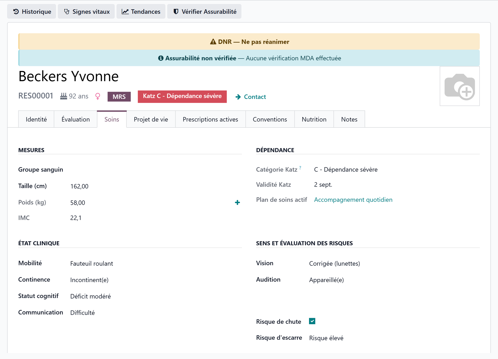
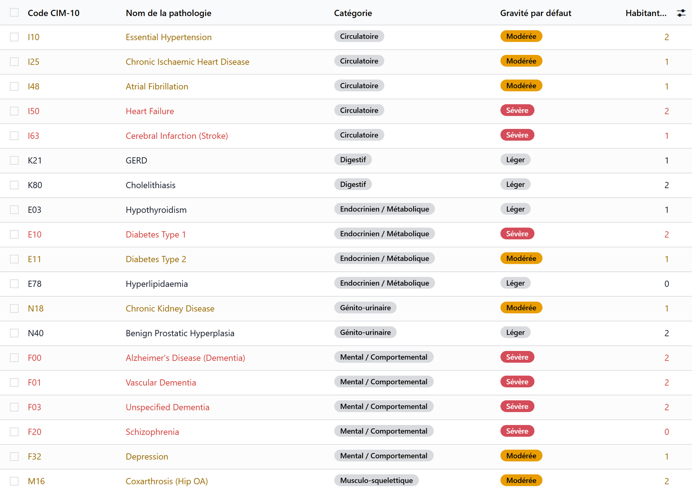
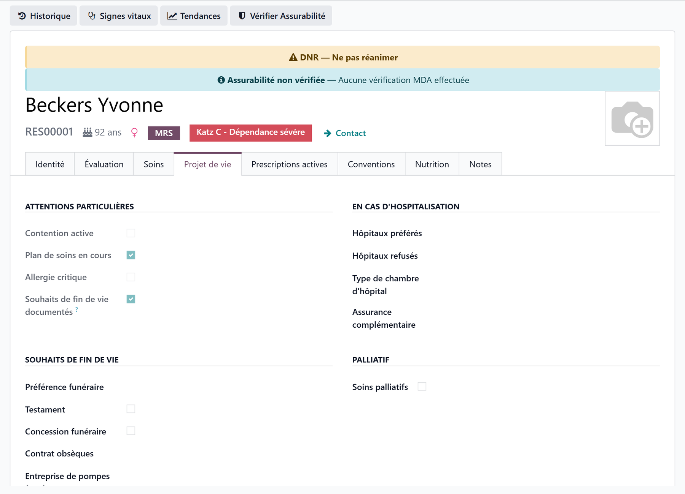

# The resident's medical record

:::{rh-description}
The resident's clinical record in Resthome: the Care tab (measurements, clinical status, devices, stools and urine, ICD-10 diagnoses, allergies, contacts), the Wishes tab, the care buttons and the medical record PDF.
:::

:::{rh-faq}
Where is a resident's medical record in Resthome?
: On the resident's form, in the **Care** tab: measurements, clinical status, senses and risks, medical devices, stools and urine, diagnoses (ICD-10), allergies, specialist doctors and medical notes. The **Wishes** tab holds the advance directives, the DNR order and the end-of-life wishes. Both tabs are reserved for care staff.

How do I record a resident's weight?
: Weight is read-only in the record: it comes from the vital signs. Use the **Vital Signs** button at the top of the form, or the small **+** next to the Weight field. The BMI is then calculated from height and weight.

How do I flag a do-not-resuscitate (DNR) order?
: In the **Wishes** tab, under **Advance Directives**, tick **DNR Order (Do Not Resuscitate)**. An orange banner appears at the top of the resident's form, a DNR badge on their card and in the list, and a **DNR** filter finds the residents concerned.

How do I export the medical record as a PDF?
: In the **Documents** tab, click the **Medical Record** tile. Choose **Summary** (the current state) or **Full** (state and history over a period), tick the sections to include, then click **Export PDF**.

Do allergies really block a prescription?
: For drug allergens, yes. A **Critical** allergy blocks the prescription of the medicine concerned; **High**, **Medium** or **Low** shows a warning. Food and environmental allergies are for documentation.
:::

The resident's **medical record** is the care part of the resident's form,
opened from **Nursing Care → Residents → All Residents** (or from the
**Residents** app). It is spread over the tabs **Care**, **Treatments**,
**Wishes** and **Documents**, and over a row of buttons at the top of the form.

:::{admonition} Access restricted to care staff
:class: warning

The care tabs, buttons and badges are only shown to **care staff**, and only
for a person followed in care. Changes to medical data are **logged**
(traceability and data protection).
:::

## The buttons at the top of the form

In the header:

- **Create the care plan** — shown while the resident has no plan in force; it
  opens a new plan. Once a plan exists, the button reads **Care Plan** and opens
  it. It is not offered for a resident who has left for good or has died. See
  [Care plans](plans-de-soins.md).
- **Vital Signs** — records a set of measurements; **Trends** draws their
  curves. See [Observations and vital signs](observations.md).
- **Hospital departure** (or **Return from hospital** while the resident is in
  hospital) — see [Hospital departure and return](hospitalisation.md).

The smart buttons count and open:

| Button | Opens |
|---|---|
| **Treatments** | The resident's treatments |
| **Pharmacy's Deliveries** | The pharmacy's sachets received for the resident |
| **Observations** | The resident's observations, as a list |
| **History** | The same observations on a calendar |
| **Scheduled** | The care tasks still planned |
| **Care (2 yrs)** | What was planned, done and missed over this year and the previous one |

## The Care tab

### Measurements and dependency

| Field | Purpose |
|---|---|
| **Blood Type** | The resident's blood type |
| **Height (cm)** | Entered once |
| **Weight (kg)** | Read-only: the last weight recorded in the vital signs |
| **BMI** | Calculated from weight and height |

:::{admonition} Weight goes through the vital signs
:class: tip

Use **Vital Signs** at the top of the form, or the small **+** next to the
weight. The BMI then recalculates on its own.
:::

The **Dependency** group shows, read-only, the **Active Care Plan** and, when
the country pack provides a dependency scale, the current dependency category.

:::{admonition} In Belgium
:class: rh-country rh-country-be

The Dependency group shows the current Katz category and the end of validity of
the Katz assessment, and a **Katz** button opens the assessments. See
[Care in Belgium](../belgique/soins.md).
:::

<!-- screenshot to update: the tab is now named "Care"; Medical Devices shows "Gastric Tube"; the Stools and Urine groups follow the senses -->

### Clinical status, senses and risks

| Field | Values |
|---|---|
| **Mobility** | Autonomous · Cane · Walker · Wheelchair · Bedridden |
| **Continence** | Continent · Occasional Incontinence · Frequent Incontinence · Incontinent |
| **Cognitive Status** | Normal · Mild Impairment · Moderate Impairment · Severe Impairment |
| **Communication** | Normal · Difficulty · Non-verbal · Aphasia |
| **Vision** | Normal · Corrected (Glasses) · Impaired · Blind |
| **Hearing** | Normal · Hearing Aid · Impaired · Deaf |
| **Fall Risk** | Yes / No |
| **Pressure Sore Risk** | Low · Moderate · High |

### Medical devices

- **Urinary Catheter**, **Stoma** and **Gastric Tube** (yes / no);
- **Dental Status**: Natural Teeth · Partial Denture · Full Denture ·
  Edentulous.

The devices also appear on the resident's **Nutrition** care tasks, where they
change how the meal is given. See [Care tasks](taches-de-soins.md).

### Stools and urine

Two groups, **Stools** and **Urine**, show the status of the follow-up (**Not
recorded**, **Up to date**, **To watch**, **Alert**), with **Record stools**,
**Record urine** and **History**. See [Stools and urine](selles-et-urines.md).

### Diagnoses (ICD-10 pathologies)

The **Diagnoses / Pathologies** list links the resident to pathologies of the
**ICD-10** catalogue.

| Column | Purpose |
|---|---|
| **Pathology** | The pathology from the catalogue |
| **Category** | Taken from the catalogue |
| **Severity** | Mild · Moderate · Severe, for this resident |
| **Status** | Active or Resolved |
| **Confirmed** | Clinically confirmed (yes / no) |
| **Date** | Date of diagnosis |
| **Notes** | Clinical observations |

A pathology can only be recorded **once** per resident. The same list is edited from the **Pathologies** tab
of the [care plan](plans-de-soins.md).

### Allergies

| Column | Purpose |
|---|---|
| **Allergen** | The allergen from the catalogue |
| **Category** | Drug · Food · Environmental · Contact · Insect/Venom |
| **Severity** | Low · Medium · High · Critical, for this resident |
| **Confirmed** | Clinically confirmed (yes / no) |
| **Date** | Date identified |
| **Reaction** | Description of the reaction |

:::{admonition} Drug allergens protect prescribing
:class: warning

For a drug allergen, **Critical** blocks the prescription of the medicine
concerned; **High**, **Medium** or **Low** shows a warning. See
[Prescriptions and medicines](prescriptions.md).
:::

**Additional Allergy Notes** holds, in free text, what is not in the list.

### Medical contacts and notes

- **Specialist Doctors** — one or more doctors.
- **Medical Notes** — anything important that fits nowhere else.

The **Attending Physician** and the resident's pharmacist are set on the
**Identity** tab, with the administrative record.

## The Treatments tab

The resident's running treatments, the same as in the medicines workstation.
**Add a line** opens a new treatment; a treatment is stopped, never deleted.
See [Prescriptions and medicines](prescriptions.md).

## The Wishes tab

What the resident wants for a hospitalisation and for the end of life:

- **Advance Directives** — **Has Advance Directive** (with its content) and
  **DNR Order (Do Not Resuscitate)**.
- **Special Attentions** — **Active Restraint**, **Ongoing Care Plan**,
  **Critical Allergy** and **End-of-life Wishes Documented**: flags taken from
  the record.
- **In Case of Hospitalisation** — preferred and refused hospitals, room type,
  complementary insurance.
- **End-of-life Wishes** — funeral preference, will, burial concession,
  funeral contract, funeral home, notary.
- **Palliative** — palliative status, its start date, and whether the
  resident and their representative agreed.
- **Instructions** — end-of-life and hospitalisation instructions.

These wishes are usually gathered with the [anamnesis](anamnese.md), which
writes into the same fields.

<!-- screenshot to update: the advance directives now sit at the top of the "Wishes" tab -->

:::{admonition} The DNR is flagged everywhere
:class: warning

As soon as **DNR Order (Do Not Resuscitate)** is ticked:

- an **orange banner** "DNR — Do Not Resuscitate" appears at the top of the
  resident's form;
- a **DNR** badge shows on the resident's card and a **DNR** column in the
  list;
- a **DNR** filter finds the residents concerned.
:::

## Badges on the resident's card

On the residents' kanban, care staff also see: **Restraint**, **Critical
allergy**, **Advance directives**, **No care plan** and **Undernutrition**.

## The Documents tab

The care tiles of the **Documents** tab:

- **Medical Record** — the record as a PDF: **Summary** (current state) or
  **Full** (state and history over a period, with **From** and **To**). Tick
  the sections — medical summary, advance directives, care plan, treatment
  history, administration history, vital sign curves, clinical assessments,
  record reviews, observations — and click **Export PDF**.
- **Medication Sheet** — what the resident takes, on one page.
- **Liaison Pack** — for the hospital: treatments, allergies, directives.

## Key points to remember

- The medical record is the **Care** tab, with **Treatments**, **Wishes** and
  **Documents**; it is reserved for care staff and logged.
- The **weight** comes from the vital signs; the **BMI** is calculated.
- **ICD-10** diagnoses and allergies carry a severity specific to the
  resident; drug allergens protect prescribing.
- Advance directives and the **DNR** live in the **Wishes** tab and are
  flagged on the form, the card and the list.

## Further reading

- [Care plans](plans-de-soins.md)
- [Observations and vital signs](observations.md)
- [Anamnesis](anamnese.md)
- [Prescriptions and medicines](prescriptions.md)
