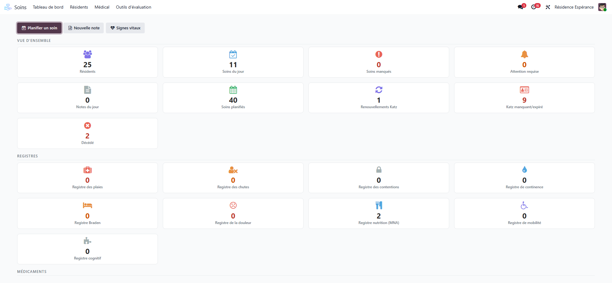

# Care

:::{rh-description}
The Nursing Care and Care Tasks apps of WideCare: medical record, care plans, care tasks, observations, multidisciplinary meetings and clinical registers for the follow-up of residents.
:::

:::{toctree}
:hidden:

tableau-de-bord
dossier-medical
anamnese
projet-de-vie
plans-de-soins
taches-de-soins
assignation-automatique
observations
selles-et-urines
evaluations-a-valider
reunion-pluridisciplinaire
registres
hospitalisation
prescriptions
configuration-soins
:::

:::{rh-faq}
Which apps cover care in WideCare?
: Two apps. **Nursing Care** holds the clinical work: the dashboard, the resident's record, observations, assessments, care plans, meetings, registers, medicines and reports. **Care Tasks** is the worklist of the shift: today's care, the care assigned to you and the care still to assign.

Who can open the care apps?
: Care staff only. A user without a care role does not see the Nursing Care and Care Tasks tiles, and the Care tab of a resident is hidden from them.

Where do I start my shift?
: On the **Dashboard** of the Nursing Care app. It shows what needs a hand now, today's agenda and the residents to keep an eye on, for the whole house or for one sector.
:::

The care side of WideCare is split into two apps that share the same data:

- **Nursing Care** — the clinical workspace: the dashboard, the resident's
  record, observations, assessments, care plans, multidisciplinary meetings,
  clinical registers, medicines and reports.
- **Care Tasks** — the worklist: the care tasks that the care plans create
  every day, for the shift to pick up and record.

Both apps are reserved for care staff. On the go, the same work is done from
the [WideCare app](../soins-mobile/index.md).

<!-- screenshot to update: the dashboard is now the care board (Today / Follow-up / Record tiles, "New" button, sector picker, "To do now", "Keep an eye on", "Today's agenda"); the old counters and the removed registers (Braden, pain, MNA, mobility, cognition) must go -->

## The Nursing Care menus

- **Dashboard** — the care board, see [The care dashboard](tableau-de-bord.md).
- **Residents** — **All Residents**, **Absences** (when billing is installed)
  and **Life Projects**.
- **Care** — the clinical menu, in four sections:
  - **Observations** — **Observations**, **Attention Required**,
    **Observations to read**, **Stools and Urine** and **Stool and Urine
    Observations**;
  - **Assessments** — **Evaluations to Validate** and **Anamneses**, plus the
    country's dependency assessment;
  - **Plans and Meetings** — **Care Plans**, **Objectives**,
    **Multidisciplinary Meetings** and **Reviews in Meeting**;
  - **Registries** — the seven clinical registers.
- **Medicines** — one entry that opens the Medicines workstation, see
  [Medicines](../medicaments/index.md) and [Prescriptions](prescriptions.md).
- **Evaluation Tools** — the assessment scales (MMSE, Braden, MNA, OHAT,
  Tinetti, pain), see [Geriatric assessments](../residents/evaluations.md).
- **Reports** — **Record Reviews**, **Plan Reviews** and the other care
  reports.
- **Configuration** — settings and catalogues, among them **Clinical
  Catalogues** (dosages, allergens, pathologies); see
  [Care configuration](configuration-soins.md).

:::{admonition} In Belgium
:class: rh-country rh-country-be

The **Assessments** section also lists the **Katz Evaluations**: see
[Care in Belgium](../belgique/soins.md) and [The Katz assessment](../belgique/katz.md).
:::

## The Care Tasks menus

- **Care Tasks** — **Today's Care**, **My Assigned Care**, **My Care Plans**,
  **My Objectives**, **To Assign** and **Care Schedule**.
- **Configuration** (managers) — the care catalogues the tasks run on.

See [Care tasks](taches-de-soins.md).

## How the pieces fit together

1. The **anamnesis** and the **life project** describe who the resident is
   and what they want.
2. The **care plan** turns this into **objectives** and **care lines**, each
   with its rhythm.
3. Every night, the care lines become **care tasks** for the coming days; the
   shift records each one as done, not done or postponed.
4. **Observations**, **assessments** and **registers** record what happens;
   they feed the **multidisciplinary meeting**, which re-reads the plan and
   adjusts it.

:::{admonition} Separate but connected
:class: note

The care apps are separate from billing, but **connected to the residents**: a
[hospital departure](hospitalisation.md) recorded on the care side opens, on
the billing side, an [absence](../facturation/absences.md).
:::

## Going further

- [The care dashboard](tableau-de-bord.md)
- [The resident's medical record](dossier-medical.md)
- [Care plans](plans-de-soins.md)
- [Care tasks](taches-de-soins.md)
- [Medicines](../medicaments/index.md)
- [Observations and vital signs](observations.md)
- [Multidisciplinary meetings](reunion-pluridisciplinaire.md)
- [Clinical registers](registres.md)
