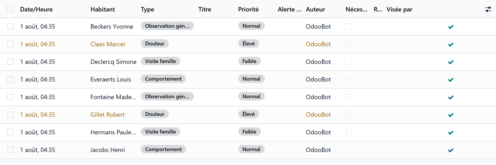

# Observations and vital signs

:::{rh-description}
Observations in WideCare: write what you saw, with its type, priority, body location, vital signs, pain, wound or incident, the head nurse's reading of falls, and the vital signs entry with its trends.
:::

:::{rh-faq}
Where do I write an observation?
: **Nursing Care → Care → Observations → Observations**, then **New**. Or from a care task, an objective or the resident's form with the **Observation** button, or with **New → Observation** on the care dashboard.

What does "To read" mean on an observation?
: The observation waits for a head nurse to read it. A fall always does; the head nurse clicks **I have read it**. A fall written by a head nurse waits for another head nurse.

How do I record blood pressure, temperature or weight?
: With **Vital Signs** on the resident's form or on the care dashboard. Out-of-range values show an alert at once; **Trends** draws the curves.

Can I correct an observation after saving it?
: Only its author can, while it is open. Once read by a head nurse or resolved, it is closed: a head nurse can **Reopen** it, with a reason, so that the author corrects it.

What makes a resident come up first at the next meeting?
: An observation of a critical type. Falls and incidents are always critical; the other types are set under Observation Types.
:::

An **observation** is what a carer saw, dated and signed: a change in
behaviour, a pain, a wound, a fall, a visit. Observations feed the care plan,
the [multidisciplinary meeting](reunion-pluridisciplinaire.md) and the
resident's history.

## Find the observations

- **Nursing Care → Care → Observations → Observations** — all observations.
- **Nursing Care → Care → Observations → Attention Required** — the observations flagged for attention.
- **Nursing Care → Care → Observations → Observations to read** — the observations waiting for a head nurse.

On the resident's form, **Observations** lists theirs and **History** shows them
on a calendar.

<!-- screenshot to update: the list of observations with the "To read" ribbon and the current filters -->

## 1. Write an observation

1. Click **New**.
2. Pick the **Resident** and the **Type**: General Observation, Vital Signs,
   Wound Care, Behavior, Continence, Pain, Fall, Incident, Family Visit, Doctor
   Visit, Transfer, Other.
3. Set the **Priority**: Low, Normal, High or Urgent. A fall or an incident is
   always high.
4. Write what you saw in the **Observation** tab. **Body location** marks where,
   on a body drawing or in a list, as the house chose.
5. Tick **Requires Attention** when the team must act on it.
6. Save. The title is built from the type, the resident and the date.

The type opens its own tab:

| Tab | What it holds |
|---|---|
| **Vital Signs** | The measurements of the moment |
| **Pain** | The pain level from 0 to 10 and where it hurts |
| **Wound Care** | Photo, identification, dimensions, assessment, treatment and the decision |
| **Incident** | What happened, the witnesses |
| **Follow-up** | What was done afterwards |
| **Photos** | The photos taken |

An observation written from a care task or an objective stays linked to it.

## 2. Read the observations

- **I have read it** adds your name to **Read By**.
- An observation **To read** waits for a head nurse: the ribbon stays until a
  head nurse clicks **I have read it**.
- **Mark Resolved** closes an observation that required attention: a head
  nurse, a physician, the management or the person it was handed to does it.
- Only its author can correct an observation. Once read by a head nurse or
  resolved, it is closed: to add something, log a note in its thread.
- **Reopen** (head nurse, physician or management) lets the author correct a
  closed observation; the reason stays in its thread.

:::{admonition} A fall always waits for a head nurse
:class: warning

A **Fall** observation stays **To read** until a head nurse has read it. When a
head nurse writes it, another head nurse reads it. The setting **Falls** in
**Nursing Care → Configuration → Settings** chooses how the head nurses are
told: by an activity only, or also by email.
:::

## 3. Search the observations

Filters: **Today**, **Urgent**, **High Priority**, **Vital Alert**, **Handed to
me**, **On My Objectives**, **Not Read by Me**, **Attention Required**,
**Observations to Read**, **Observations Read**, and by type: **Vital Signs**,
**Wound Care**, **Falls**, **Incidents**, **Pain**. Group by resident, type,
priority, author or date.

## Vital signs

Click **Vital Signs** on the resident's form, or **New → Vital signs** on the
[care dashboard](tableau-de-bord.md).

1. Check the **Resident** and the date and time.
2. Read the **Last Readings** for comparison.
3. Enter what you measured:
   - **Blood Pressure** — systolic and diastolic;
   - **Vital Parameters** — temperature, heart rate, respiratory rate, oxygen
     saturation;
   - **Other Measurements** — blood sugar, weight, notes.
4. A banner warns at once of any value outside the **Reference Norms**.
5. Click **Save**.

The measurements become a **Vital Signs** observation. The weight updates the
resident's record and their BMI.

### Trends

**Trends** on the resident's form opens **Vital Signs Trends**: pick the
measure, then **View Trends** to see its curve over time.

## Configure the observations

- **Nursing Care → Configuration → Observation Types** — drag the types into
  the order the meeting reads them, and mark which are **Critical**. Falls and
  incidents are always critical.
- **Nursing Care → Configuration → Settings** — **Body location entry**
  (drawing or list) and the **Falls** reading.

## Going further

- [Stools and urine](selles-et-urines.md)
- [Clinical registers](registres.md)
- [The resident's medical record](dossier-medical.md)
