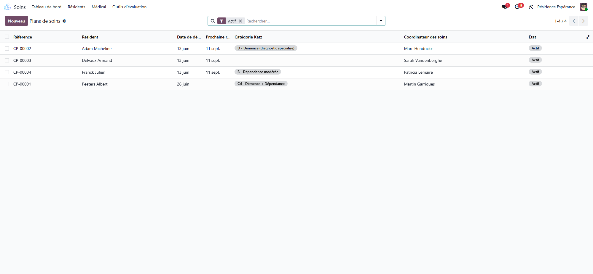
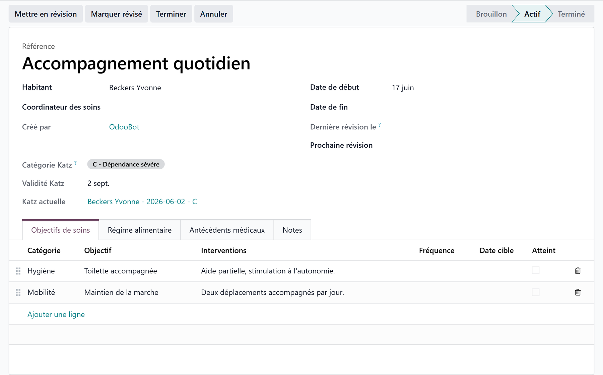

# Care plans

:::{rh-description}
Care plans in Resthome: objectives and care lines with their moments of the day, hour and frequency, templates to add or replace, suspension, stop and archive, periodic review and the care plan coordinator.
:::

:::{rh-faq}
What is a care plan in Resthome?
: The plan of a resident's care: **objectives** (why) and **care lines** (what is done, when and how often). Every night, the care lines become care tasks for the coming days. A resident has one live plan at a time.

Can I delete a care line?
: Only on a **draft** plan, for a care that nothing has happened on: the bin removes it. On a plan in force, a care is part of the record: stop it, or stop and archive it, with a reason. It then moves to **Care History**.

Why can't I activate the care plan?
: A plan cannot be put in force for a resident who no longer has a stay in the house (departed for good or deceased). The resident's form then no longer offers **Create the care plan**.

How do I give the same care morning and evening?
: On one line: pick several **Moments of the Day**. A single moment can carry a precise **Hour**; left empty, the care takes the start of its moment.

What happens when I pick a template on a plan that already has content?
: Resthome asks first. On a draft plan you choose **Add to the plan** (what is already there is kept and duplicates are skipped) or **Replace everything** (what was written on the draft goes; care already given or noted stays). On a plan in force, a template can only be added.
:::

A **care plan** describes the care of one resident: the **objectives** the
team pursues and the **care lines** that are carried out every day. It lives in
the **Nursing Care** app, under **Nursing Care → Care → Plans and Meetings →
Care Plans**.

## Open or create a plan

- From the resident's form: **Create the care plan** when there is none, or
  **Care Plan** to open it.
- From the list **Care Plans**: **New**, then pick the resident.
- From a [multidisciplinary meeting](reunion-pluridisciplinaire.md): **Create
  the care plan** on the resident's card.

The nurse who opens the plan becomes its **Care Coordinator** by default. A
plan in force must have one.

:::{admonition} One live plan per resident
:class: note

A resident has a single live plan (draft, active or under review). A plan
cannot be activated for someone who no longer has a stay in the house: the
end of the stay closes the plan.
:::

<!-- screenshot to update: the list now also shows the sector -->

## The plan's life cycle

| State | Meaning |
|---|---|
| **Draft** | Being written: lines can still be edited or removed |
| **Active** | In force: its care lines create care tasks |
| **Under Review** | Being revised |
| **Completed** | Closed, usually at the end of the stay |
| **Cancelled** | Cancelled |

The buttons follow the state:

- **Activate** — puts a draft in force.
- **Review the plan** — opens a revision; the button turns blue when the
  review is overdue.
- **Confirm without change** — records the periodic review when nothing needs
  to change.
- **Validate Review** — closes a revision and records it.
- **Reopen** — brings a completed or cancelled plan back to draft.
- **Apply a template** — see below.

Under **Actions**: **Cancel the plan** (refused on a plan already closed) and
**Save as template**.

<!-- screenshot to update: header is now Activate / Review the plan / Confirm without change / Apply a template; tabs are Care Lines, Objectives, Pathologies, Treatments, Nutrition, Notes, Info; smart buttons on top -->

## The plan form

At the top, the **resident** (with their dependency category), **Start from
template**, the **Care Coordinator** and the sector; on the right the **Start
Date**, **End Date**, **Last Reviewed On**, **Next Review**, the review status
(**Up to date**, **Due soon**, **Overdue**) and the share of care delivered.
A **Review overdue** ribbon marks a plan whose review is late, and a yellow
note warns when the resident is away.

Smart buttons:

| Button | Opens |
|---|---|
| **Today's tasks** | The plan's care tasks of the day |
| **Scheduled** | The planned care tasks |
| **Missed care** | Care nobody answered for |
| **Care History** | Care stopped, revised or archived |
| **Objectives** | The objectives |
| **Reviews** | The plan's past reviews |
| **Prescriptions** | The resident's prescriptions |
| **To consider** / **Evidence** | What assessments and registers proposed for this plan |

Tabs: **Care Lines**, **Objectives**, **Pathologies** (the resident's
diagnoses, the same list as on their record), **Treatments** (the resident's
running treatments, given through the medication round, not through care
lines), **Nutrition**, **Notes** and **Info**.

## 1. Add a care

Click **Add a care** in the **Care Lines** tab.

1. Pick the **Activity**: its **Care Type**, duration and the text the carer
   will read fill in.
2. Adjust **What the carer will read**.
3. Set the **Rhythm**:
   - **Frequency** — Daily, Weekly, Every Two Weeks, Every Second Day, Monthly
     or Custom;
   - **Moments of the Day** — one or several (Morning, Noon, Afternoon,
     Evening, Night…);
   - **Hour** — for a single moment, a precise hour; left empty, the care
     starts at the beginning of its moment;
   - **Weekdays** — required for a weekly or custom rhythm.
4. Set the **Period**: **Starts** and, under **More options**, **Until**.
5. **More options** also offers the plan, the objective, the department, tags,
   occurrences, duration, **Criticality** and the **Reason**.
6. Click **Add to the plan**. The tasks of the day appear on the worklist at
   once.

:::{admonition} One line, several moments
:class: tip

The same care morning **and** evening is one line with two moments. An hour
belongs to one moment: with several moments, each starts at its own time.
:::

On a plan in force, lines typed by hand in the list are planned by the nightly
run; **Generate Tasks** plans them at once.

## 2. Read the care lines

Each line shows the activity, care type, department, what the carer reads,
frequency, moments, hour, weekdays, occurrences, criticality, dates, the
number of care **Done** and **Missed**, its **Origin** (the record it was
decided from) and its **Status**:

| Status | Meaning |
|---|---|
| **Draft** | On a draft plan |
| **In force** | Carried out |
| **Starts later** | Begins at a future date |
| **Stops today** | Ends tonight, greyed |
| **Suspended** | On hold for a few days |
| **Revised** | Replaced by a newer version |
| **Stopped** / **Archived** | No longer carried out |

## 3. Change, suspend or stop a care

The icons at the end of a line, on a plan in force:

- **Revise this care** — closes the current line the day before the new one
  starts, and links the two. The plan can still say what was in force last
  month.
- **Suspend this care for a few days** — no task on those days; the care
  resumes by itself the day after. **Resume this care now** ends the
  suspension early.
- **Stop this care today** — asks for a reason; what is still planned after
  today is cancelled, what was given stays on the record.
- **Stop and archive this care** — stops it today and moves it to **Care
  History**, with its reason.
- **Open the record this care was decided from** and **See the care tasks**.

:::{admonition} The bin is for drafts only
:class: warning

On a **draft** plan, a care nothing has happened on shows a bin: **Remove this
care, added by mistake**. Resthome confirms that nothing stays on the care
file. On a plan in force there is no bin: a care is part of the record for
years, so it is stopped or archived with a reason. The same rule applies to
objectives.
:::

A care in **Care History** can be brought back from there.

## 4. Start from a template

Pick a template in **Start from template**, or click **Apply a template**. The
dialog shows the resident, their dependency category, the template, **Care
starts on**, **What this template assumes** and **What will be done**.

- On an **empty** plan, the template is simply applied.
- On a **draft** plan that already holds objectives or cares, choose **Add to
  what is already on the plan** or **Replace everything with this template**,
  then **Add to the plan** or **Replace everything**.
- On a plan **in force**, the template's objectives and cares are added.

Templates are listed with the one matching the resident's dependency category
first. To build one from a plan, use **Actions → Save as template**. See
[Care configuration](configuration-soins.md).

## 5. Objectives

The **Objectives** tab lists each objective with its **Category** (Hygiene,
Mobility, Nutrition, Medication, Social, Cognitive, Pain, Skin Care,
Elimination, Sleep, Other), **Objective**, **Interventions**, **Assigned To**,
**Target Date**, the care **Planned**, **Done** and **Missed**, and
**Achieved**.

An objective opened on its own form has:

- **Observation** — writes an observation linked to the objective;
- **Open the Care Plan**;
- the tabs **Interventions**, **Planned Care** (with **Plan the Care**, which
  adds the care that serves the objective to the plan), **Observations** and
  **Evaluation**.

**Nursing Care → Care → Plans and Meetings → Objectives** lists all objectives
(filters **My Objectives**, **Unassigned**, **In Progress**, **Achieved**). An
objective written from the [life project](projet-de-vie.md) lands here too.

## 6. Evidence to consider

When an assessment or a register is validated, it is cited on the plan as a
proposal. **To consider** opens the proposals still to decide: **Take into
account** or **Do not retain**, with the reason. The citation keeps what the
assessment said that day.

## 7. Review the plan

The plan is reviewed periodically; the **Next Review** date follows the house's
cadence or the country's rules.

- Nothing to change: **Confirm without change**.
- Changes: **Review the plan**, adjust, then **Validate Review**.

Each review is written down: who, when, what changed and the conclusion.
**Nursing Care → Reports → Plan Reviews** lists them (filters **Confirmed
without change**, **Adapted**, **In a meeting**). A
[multidisciplinary meeting](reunion-pluridisciplinaire.md) also records a
review.

:::{admonition} In Belgium
:class: rh-country rh-country-be

A nursing-home care plan is reviewed every 30 days; a day-care user's plan
once a year. The plan shows the resident's Katz category. See
[Care in Belgium](../belgique/soins.md).
:::

## Find a plan

Filters: **My Care Plans**, **No Coordinator**, **My Sectors**, **Active**,
**Under Review**, **Drafts**, **Completed**, **Cancelled**, **Review Due**,
**Review due soon**. Group by resident, coordinator, state, sector or
dependency. **Care Tasks → Care Tasks → My Care Plans** lists the plans you
coordinate.

## Going further

- [Care tasks](taches-de-soins.md)
- [Multidisciplinary meetings](reunion-pluridisciplinaire.md)
- [Care configuration](configuration-soins.md)
- [Observations and vital signs](observations.md)
- [Capability observation (Potentia)](../qualite/observation-capacites.md) — care plan objectives drawn from a capability observation.
