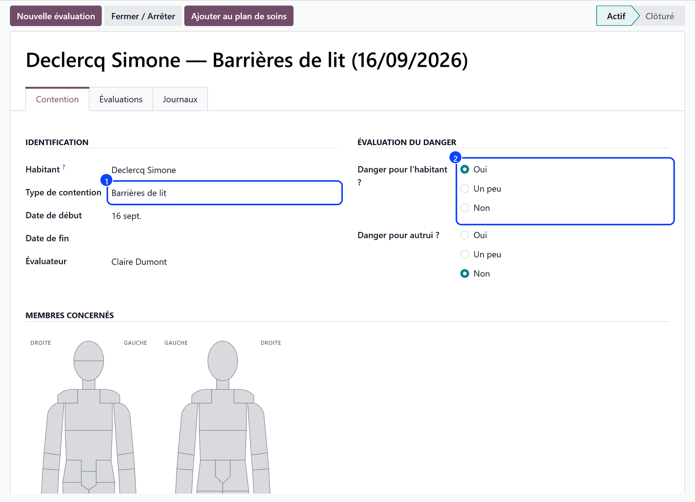
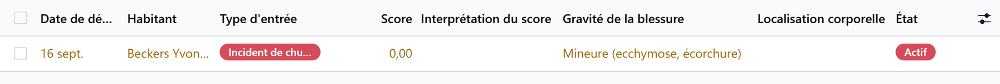
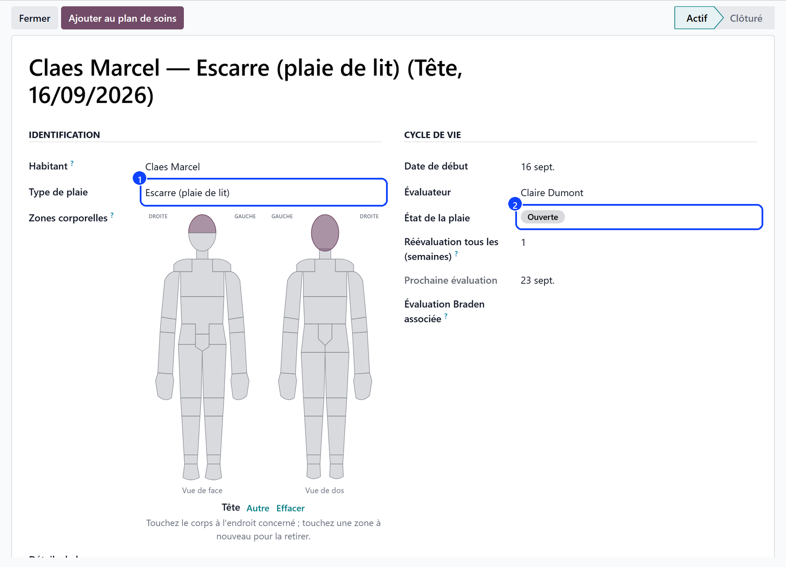

# Clinical registers

:::{rh-description}
The WideCare clinical registers — restraint, falls, continence, wounds, infections, invasive procedures and isolation — opened, re-evaluated on a rhythm, turned into planned care and closed for each resident.
:::

:::{rh-faq}
Which registers does WideCare provide?
: Seven: restraint, falls, continence, wounds, infections, invasive procedures and isolation. They record **events**, over time, for one resident.

Where are the registers?
: In the **Nursing Care** app, under **Care → Registries**. Each register has its own menu and its tile on the care dashboard.

What is the difference between a register and an assessment scale?
: A register records events — a fall, a wound, an isolation. A scale measures a state at a given moment: Braden, MNA, Tinetti, MMSE, the pain scales. The scales are described under [Geriatric assessments](../residents/evaluations.md).

Who can reopen a closed register?
: A head nurse (the management for some registers). A register stays open as long as the situation lasts and is closed when it is over.

Does a register change the care plan by itself?
: No. **Add to the care plan** proposes a care built from what the register observed; you decide what goes on the plan.
:::

**Clinical registers** are the memory of what happened: a fall, a wound, an
episode of infection. Each register follows one theme, for one resident, over
time — which is what an inspection, a handover or a family conversation needs.

## The seven registers

All under **Nursing Care → Care → Registries**:

| Register | What it records |
|---|---|
| **Restraint Registry** | Every restraint measure, its reason, its prescription, its consent and its checks |
| **Fall Registry** | The fall-risk assessments and the falls |
| **Continence Registry** | The continence situation and the toileting programme |
| **Wound Registry** | Wounds, their care and their healing |
| **Infection Registry** | Infection episodes and the measures taken |
| **Procedure Registry** | Invasive devices: catheter, venous line, tube, stoma… |
| **Isolation Registry** | Isolation measures and their follow-up |

:::{admonition} A register is not a scale
:class: note

A register records **events**. A **scale** measures a state at a given moment —
Braden, MNA, Tinetti, MMSE, the pain scales. They are filled in from the
resident's record or from the [care app](../soins-mobile/evaluations.md), and
are described under [Geriatric assessments](../residents/evaluations.md).
:::

## What every register shares

- A state: **Active** or **Closed**.
- **Re-evaluation Every** (weeks), with the **Next Evaluation** and the **Last
  Evaluation**. A register due for re-evaluation shows up in the list's filter
  and in the [multidisciplinary meeting](reunion-pluridisciplinaire.md).
- An **Evaluations** tab: each re-evaluation records what was seen and the
  **Decision** taken.
- **Close** when the situation is over; **Reopen** (head nurse) if it comes
  back.
- **Add to the care plan** (restraint, fall, wound): turns what the register
  observed into a proposed care; you decide. **Care Lines** shows the care
  that came from it.

## Restraint

1. Pick the **Restraint Type**: Bed Rails, Pelvic Belt, Wheelchair Tray, Wrist
   Restraint, Vest Restraint, Probe / Staple, Chemical Restraint (Medication),
   Other.
2. Write the reasons and the **Danger Assessment**, the **Limbs concerned** and
   the **Alternative Measures** tried first.
3. Record the **Medical Prescription** (its date and planned duration in days),
   the **Monitoring** and the **Consent** — from the resident, their legal
   representative or a family member.
4. The **Logs** tab notes each placement, removal and check, with the skin and
   comfort.

**New Evaluation** re-evaluates the measure: maintain, stop or change the
modality. **Close / Stop** ends it. Where the law requires the physician's
countersignature, **Countersign** records it. Filters: **Active**, **Needs
Re-evaluation**, **Closed**.

<!-- screenshot to update: header now shows New Evaluation, Add to the care plan and Close / Stop -->

## Falls

An entry is either a **Risk Assessment** or a **Fall Incident**.

- **Risk assessment** — the **Morse Fall Scale**: history of falling, secondary
  diagnosis, ambulatory aid, IV or heparin lock, gait, mental status. The score
  gives **Low**, **Moderate** or **High Risk**.
- **Fall incident** — the hour, the location, the witnesses, the circumstances,
  the **Injury Severity** (No Injury, Minor, Moderate, Major), the **Injured
  Zones** on a body map, the actions taken, whether the physician and the
  family were notified, and **Photos**.
- **Preventive Measures** — environment adapted, walking aid provided,
  medication reviewed, footwear adapted, lighting improved.

:::{admonition} Every fall is read by a head nurse
:class: warning

A fall waits for a head nurse's reading: a banner says so until a head nurse
clicks **I have read it**. For a serious fall, a banner reminds that the family
has not been informed yet: **Inform the family** prepares the email to the
resident's contact persons.
:::

A fall written as an observation can be opened in the fall register, and a
fall creates a record review. Filters: **Assessments**, **Incidents**,
**Active**, **High Risk**, **To Read**, **Read**.

## Continence

The **Type** of incontinence, its **Frequency** (Occasional, Frequent,
Permanent) and the **Toileting Program**. Decisions at re-evaluation: maintain,
change the protection, start a toileting programme, refer.

## Wounds

The **Wound Type**, its **Location** on the body map, the **Date of Onset**
and its **Origin**, the stage for a pressure ulcer, the exudate, edges and
tissue, and the **Wound State**: **Open**, **Healing**, **Healed** or
**Reopened** (with the **Date Healed**). Tabs: **Initial Assessment**,
**Evaluations**, **Documents**, **Notes**.

Decisions at re-evaluation: continue the current care, change the dressing
protocol, refer to a specialist, escalate, mark healed. Filters: **Open**,
**Healing**, **Healed**, **Reopened**, **Pressure Ulcers**.

## Infections

The site, the origin, a **Multi-resistant** ribbon, the sample, the
**Antibiotic Therapy**, whether isolation is required and the coordinating
physician informed, and the **Outcome**: Ongoing, Cured, Hospitalised,
Deceased. Tabs: **Management** and **Evaluations**.

## Procedures

The device — Urinary Catheter, Venous Line, Gastrostomy (PEG), Nasogastric
Tube, Tracheostomy, Oxygen Therapy, Stoma, Drain, Other — with **Replacement
Every** (days), the **Replacement Due** date and whether a **Medical
Prescription** is on file. Decisions: maintain, replace, remove, refer.

## Isolation

The **Precaution Type** (Contact, Droplet, Airborne, Protective Isolation),
single room, signage at the door, family informed, and whether a physician
prescribed it (a warning shows when not). Tabs: **Reason and Criteria**,
**Related Infections**, **Evaluations**. Decisions: maintain, downgrade the
precautions, lift. **Lift Isolation** closes it.

## What feeds the registers

- The **WideCare app** writes into the registers from the bedside: a fall
  observation, a wound observation with its photo and its measurements, a
  continence observation. See [Observations](../soins-mobile/notes.md).
- An observation of a fall or a wound offers **Open in the fall register** or
  **Open in the wound register**.
- The [multidisciplinary meeting](reunion-pluridisciplinaire.md) can ask for a
  new entry (Register a fall, Open a wound register, New restraint…) as a care
  task to plan.

## Going further

- [Observations and vital signs](observations.md)
- [Geriatric assessments](../residents/evaluations.md)
- [Care plans](plans-de-soins.md)
