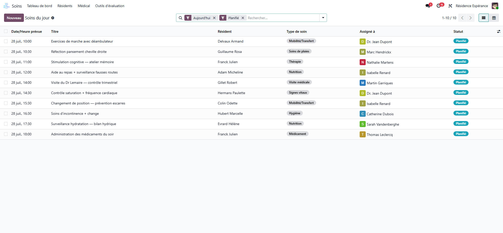
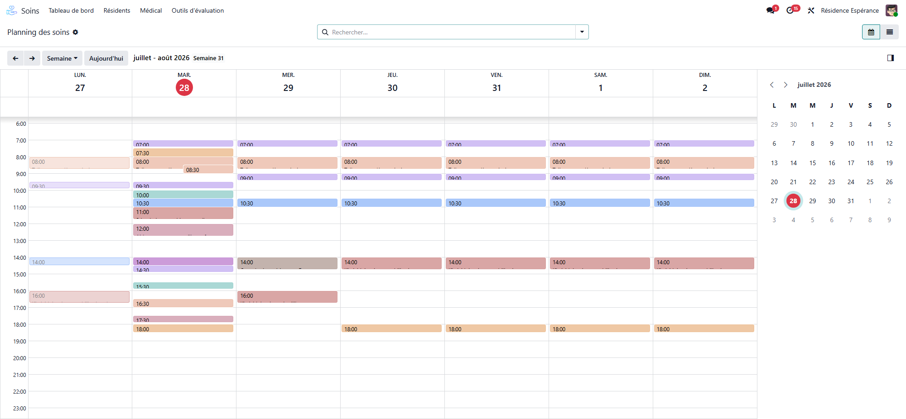

# Care tasks

:::{rh-description}
The care tasks in Resthome: the worklist of the day by room, done, not done, postponed or missed care, countersigning, care added on the spot, the care schedule and the outcome reasons.
:::

:::{rh-faq}
Where do care tasks come from?
: From the care lines of the residents' [care plans](plans-de-soins.md). Every night, Resthome plans the care of the next seven days, never for a moment already over. A care can also be added on the spot.

What is the difference between Not done and Missed?
: **Not done** is an answer: someone says why the care was not given (refused, asleep, absent…). **Missed** means nobody answered: Resthome marks the care missed two hours after the end of its moment, or after its planned hour.

Can I still give a care marked Not done?
: Yes. A care marked **Not done** can still be marked done or postponed later in the day.

Why was a care cancelled on its own?
: Because the resident was not there: away from the house or in hospital. The care task says so in a yellow note.

How do I move a recurring care in the calendar?
: Drag it. Resthome asks whether to move **The whole series** or **This care only**.
:::

A **care task** is one care, for one resident, at one moment. Care tasks are
the work of the care staff, in the **Care Tasks** app.

## Find your work

- **Care Tasks → Care Tasks → Today's Care** — today's care, as cards, sorted by room for the round.
- **Care Tasks → Care Tasks → My Assigned Care** — the care assigned to you, still to do.
- **Care Tasks → Care Tasks → My Care Plans** — the plans you coordinate.
- **Care Tasks → Care Tasks → My Objectives** — the objectives assigned to you.
- **Care Tasks → Care Tasks → To Assign** — today's care with nobody assigned yet.
- **Care Tasks → Care Tasks → Care Schedule** — the calendar of care.

<!-- screenshot to update: cards now show the room, the sector, the moment of the day and the "No staff planned" ribbon when it applies -->

Each card shows the resident, the room, the care, the moment of the day or
the hour, the criticality and the status.

## The statuses of a care task

| Status | Meaning |
|---|---|
| **Planned** | To do |
| **In progress** | Started |
| **Completed** | Given |
| **Not done** | Not given, with a reason |
| **Postponed** | Moved to another moment or day |
| **Missed** | Nobody answered in time |
| **Cancelled** | Cancelled, for example because the resident was away |

## 1. Give the care

1. Open the care task.
2. Read the **Care description**: what the plan asks for this care.
3. Click **Start** if the care takes time, then **Mark as Done**.
4. When the care asks for a record — a weighing, a scale, the stools — click
   **Fill in**: the form opens with the resident already set, and the record is
   linked to the care.

Your name and the time are recorded under **Completion**. The **Observation**
button writes an observation linked to the care.

:::{admonition} Nutrition care and devices
:class: tip

A **Nutrition** care shows the resident's devices (urinary catheter, stoma,
gastric tube) in a **Devices** field: the way the meal is given depends on it.
:::

For a stools or urine care, **Record the observation** opens the follow-up
directly. See [Stools and urine](selles-et-urines.md).

## 2. Not done or postponed

Click **Not Done** or **Postpone**. One sheet handles both:

1. **Answer** — Not done or Postpone.
2. For a postponement: **Postpone To** (the date), then a **Moment of the Day**
   or, with **At a Precise Time**, an hour — midnight included. A care can be
   postponed to later the same day.
3. **Reason** — required; some reasons also require a **Comment**.

A postponed care shows **Postponed to** on the original and **Postponed from**
on the new one. When a care is still owed, **Still owed until** tells until
when.

## 3. Countersign

Some care must be checked by a second person. A colleague other than the one
who gave the care clicks **Validate**: their name and the date are recorded
under **Completion**.

## 4. Missed care

A care nobody answered for becomes **Missed** two hours after the end of its
moment of the day, or two hours after its planned hour. **Mark Missed** does it
by hand. Missed care shows on the plan (**Missed care**) and in the
[multidisciplinary meeting](reunion-pluridisciplinaire.md).

## 5. Add a care on the spot

Click **New**, pick the resident and the care, and save. The care is marked
**Added on the Spot**. To make it a recurring care, open the **Options** tab:
**Recurring**, **Frequency**, **Weekdays**, **Moments**, **Hour** and **Until**.

## 6. Stop a care from the task

**Stop this care** stops the whole series behind the task: the occurrences
still planned are cancelled, care already given or missed is kept. The
**Options** tab also offers **Suspend this care** and **Resume this care**.

## The care task form

Smart buttons: **Care Schedule**, **Care Plan Line**, **Occurrences**, **Care
Plan**, **Filled in** and **Observations**.

Fields: the care, the **Resident**, the room and the sector, the **Care Type**
and **Activity**, **To Fill**, **Criticality**, **Objective**, **Starting at**,
**Duration** and the moment of the day. Under **Outcome**: the reason and the
comment of a care not done or postponed. Under **Completion**: who did it and
when, and who validated it.

## The care schedule

**Care Schedule** shows the care on a calendar, clickable by quarter hour.
Dragging a recurring care asks **Move a recurring care**: **The whole series**
or **This care only**.

<!-- screenshot to update: current calendar with moments of the day and the residents' rooms -->

## Search and group

Filters: **Today**, **This Week**, **Upcoming**, **To Do**, **Planned**, **In
Progress**, **Completed**, **Not Done**, **Missed**, **Postponed**, **Carried
Over**, **Added on the Spot**, **My Assigned Care**, and by kind: **Vital
Signs**, **Wound Care**, **Medication**, **Doctor Visits**.

Group by resident, care type, status, reason, criticality, assignee, date,
month, moment of the day or department.

## Assigning care

A care task can be assigned to a member of staff in the **Options** tab
(**Assigned to**). The house can let Resthome share the care among the staff on
the planning: see
[Automatic assignment of care tasks](assignation-automatique.md).

## Outcome reasons

The reasons offered for a care not done or postponed are listed under **Care
Tasks → Configuration → Care Outcome Reasons**: Refused by the resident,
Resident asleep, Resident absent / not in the room, Resident unwell, Not
enough time / staff shortage, Not needed today, Equipment or product missing,
Family visit / outing, Other. Each says whether it is **Used For** not done,
postponed or both, and whether it **Requires a Comment**.

## Going further

- [Care plans](plans-de-soins.md)
- [Automatic assignment of care tasks](assignation-automatique.md)
- [Care configuration](configuration-soins.md)
